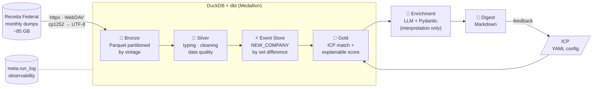

**English** · [Português](README.pt-BR.md)

<div align="center">

# 📡 Radar B2B

**Detect change. Find opportunity. Act first.**

A business-event intelligence engine built on Brazil's public company registry —<br>
it turns monthly snapshots of every registered company into **prioritized, explainable sales opportunities**.

[](https://github.com/GabrielKSG7/Radar-B2B/actions/workflows/ci.yml)


</div>

---

## At a glance

| | |
|---|---|
| **Problem** | Brazil publishes its full company registry every month, but as raw snapshots — no "what changed" feed. Sales teams that serve new businesses (accountants, consultants) find them late, by word of mouth. |
| **What it does** | Detects events by diffing consecutive monthly snapshots, matches them against a configurable **Ideal Customer Profile (ICP)**, scores each one with a transparent formula and delivers a ranked digest. |
| **What it is not** | Not a lead list, not a CNPJ lookup. It sells **context, priority and action** — every score shows the factors behind it. |
| **Scale** | ~85 GB uncompressed per monthly vintage, 10 shards per table, `cp1252`-encoded, processed on a laptop. |
| **Cost** | Runs locally, near R$ 0: DuckDB + Parquet + dbt, LLM optional (Gemini free tier). |
| **Status** | MVP. First full real-data run (2024-07 → 2024-08, all 10 shards, Minas Gerais) passed every data test and the population sanity check, yielding **42 opportunities** for the first ICP (accounting firms in southern MG). |

```
DATA → EVENT → CONTEXT → ICP → SCORE → OPPORTUNITY → ACTION → FEEDBACK
```

---

## Architecture



| Layer | Responsibility | Technology |
|---|---|---|
| Ingestion | Discover, download, validate and normalize the dumps | Python, httpx |
| Bronze | Raw data **versioned by publication vintage** | Partitioned Parquet |
| Silver | Typing, cleaning, joins, data quality | dbt + DuckDB |
| Event Store | Events detected by set difference between vintages | dbt + DuckDB |
| Opportunity Layer | ICP matching and explainable scoring | dbt + YAML config |
| Enrichment | Controlled semantic interpretation | Pydantic + LLM |
| Digest | Delivery to the user, with feedback checkboxes | Markdown |
| Observability | Run log for every stage | DuckDB (`meta.run_log`) |

---

## Sample output

An excerpt of a real digest generated by the CI pipeline from **synthetic fixtures** (names and contacts are fake). The digest is written in Portuguese because the first market is Brazilian:

> ### AURORA NOVA ERA LTDA
> **CNPJ:** `00000436000199` · **Score:** 67/100 (Média)
>
> | | |
> |---|---|
> | **Evento** | NEW_COMPANY — aberta em 2026-08-11 (há 20 dias) |
> | **Onde** | VARGINHA/MG |
> | **Setor** | Desenvolvimento de programas de computador sob encomenda (`6201501`) |
> | **Porte** | Empresa de Pequeno Porte |
>
> **Por que apareceu:** Aberta há 20 dias (+17) · CNAE secundario (+15) · Empresa de Pequeno Porte (+15) · VARGINHA (+10) · Contato disponível (+10)
>
> **Ação sugerida:** Revisar manualmente antes de abordar.
>
> `[ ] relevante   [ ] irrelevante   [ ] contatada` — motivo: ______________

Every number is traceable: the score is exactly the sum of the factors shown, and a dbt test (`assert_score_bate_com_fatores`) fails the build if it ever isn't.

---

## Key engineering decisions

| Decision | Why | Enforced by |
|---|---|---|
| **The publication vintage is a first-class citizen.** New companies are found by comparing this month's snapshot with last month's — not by filtering on opening date. | The source has no change log. Set difference makes the pipeline **idempotent** and is the base for every future event type. | `evt_new_company` + test `assert_evento_nao_existe_na_competencia_anterior` |
| **Recency is measured against the end of the vintage, never the wall clock.** | Reprocessing August 2024 today must give the same score it gave last year. With `current_date`, a 45-day window silently emptied the Gold layer. | `data_referencia()` macro |
| **Ingestion and transformation derive the vintage from one source of truth.** | When they drifted apart, the pipeline reported ten green models and produced zero events. | Orchestrator (`run_pipeline.py`) |
| **Change detection requires all ten shards in both vintages.** | Shards are not stable: 69% of CNPJs in July's shard 0 were absent from August's. A partial diff measures sampling, not company formation. | Ingestion refuses to produce a digest from partial loads; `scripts/diagnostico_eventos.py` |
| **Sector matching by CNAE code, never by description text.** | `ilike '%ti%'` matched "a**ti**vidades" — most sector descriptions — making the filter inert. | ICP YAML schema |
| **The LLM interprets; it never decides.** | Facts, score and ICP fit are deterministic. The model only writes the commercial reading, validated by Pydantic, with provenance shown in the digest. | `src/enriquecimento.py` |
| **Regression tests call production code.** | Two tests once passed against broken code because they asserted on a copy of the query. Each new test was verified to fail against the bug it guards. | `tests/` |

---

## The data, for readers outside Brazil

Brazil's federal tax authority (*Receita Federal*) publishes the national company registry as open data every month.

| Term | What it is |
|---|---|
| **CNPJ** | The national taxpayer ID for companies — the join key across the whole dataset |
| **CNAE** | The official economic-activity classification code (industry sector) |
| **Competência** | The monthly publication vintage, e.g. `2024-08`. Kept in Portuguese in the code because it names a domain concept |
| **Estabelecimentos / Empresas** | Establishments (branches, with address, sector, status) and legal entities (trade name, capital, size) |

Two properties of the source drive the architecture: it ships **monthly snapshots, not a change log**, and it is **large and messy** — handling it correctly is the barrier to entry, and `CHANGELOG.md` documents every trap.

---

## Quick start

```bash
git clone https://github.com/GabrielKSG7/Radar-B2B.git && cd Radar-B2B
python -m venv .venv && source .venv/bin/activate    # Windows: .venv\Scripts\activate
pip install -e ".[dev]"          # add ",ia" for LLM enrichment
```

**With synthetic data** (recommended first run — no 85 GB download):

```bash
python scripts/gerar_fixtures.py --anterior 2026-07 --atual 2026-08
python run_pipeline.py --competencia 2026-08 --anterior 2026-07 --somente-local --sem-ia
```

The digest lands in `data/digests/`. The fixtures reproduce the source's real defects (accents, embedded semicolons, cp1252 bytes, unquoted lines), which is what makes CI a real regression guard.

**With real data** — the pipeline *discovers* published vintages instead of guessing them:

```bash
python -m src.ingestao --listar
export GEMINI_API_KEY=...                    # optional
python run_pipeline.py --competencia 2026-08 --anterior 2026-07 --uf MG
```

Ingestion processes one shard at a time and deletes each extracted CSV before the next, so peak disk stays in the single-digit GB range instead of exceeding 100 GB.

**Before trusting a digest**, run the sanity check — it measures whether both vintages describe the same population and refuses a passing verdict otherwise:

```bash
python scripts/diagnostico_eventos.py
```

<details>
<summary><b>Running individual stages</b></summary>

```bash
python -m src.ingestao --competencia 2026-08 --uf MG
python scripts/carregar_icp.py
cd dbt_radar && dbt build --profiles-dir . \
  --vars "{competencia_atual: '2026-08', competencia_anterior: '2026-07'}"
python -m src.enriquecimento
python -m src.digest --top 20
```
</details>

<details>
<summary><b>Data source — where the files live (and what to do when downloads fail)</b></summary>

Until January 2026 the registry was published at `dadosabertos.rfb.gov.br/CNPJ/dados_abertos_cnpj/YYYY-MM/`. **That host was decommissioned.** Publication moved to a WebDAV (Nextcloud) share on `arquivos.receitafederal.gov.br`, accessed through a share token.

| Resource | Address |
|---|---|
| Share page (human) | `arquivos.receitafederal.gov.br/index.php/s/<token>` |
| WebDAV listing (used by the code) | `arquivos.receitafederal.gov.br/public.php/webdav` |
| Direct download | `arquivos.receitafederal.gov.br/public.php/dav/files/<token>/<YYYY-MM>/<file>` |
| Official catalogue | [dados.gov.br — CNPJ](https://dados.gov.br/dados/conjuntos-dados/cadastro-nacional-da-pessoa-juridica---cnpj) |
| Data dictionary | [cnpj-metadados.pdf](https://www.gov.br/receitafederal/dados/cnpj-metadados.pdf) |

**If downloads start failing**, the token has probably changed. Open the share page, navigate to *Dados > Cadastros > CNPJ*, copy the code after `/index.php/s/` and export it — no code change required:

```bash
export RADAR_RFB_SHARE_TOKEN=<new_token>
```
</details>

<details>
<summary><b>File format — three traps that cause silent data loss</b></summary>

| Property | Consequence of ignoring it |
|---|---|
| **Windows-1252** encoding (not latin-1) | Read as UTF-8, every accented row is dropped without warning; read as latin-1, DuckDB aborts the whole file |
| Double-quoted fields | The quotes end up inside the value: `"MG"` never matches `'MG'` |
| `;` inside fields and descriptions | Becomes an extra column and aborts the file |

The source is *almost* latin-1, but carries bytes `0x80–0x9F` — curly quotes and dashes typed on Windows, common in trade names. DuckDB cannot read cp1252, so **extraction** normalizes everything to UTF-8 (at no extra I/O cost) and the rest of the pipeline reads UTF-8. Details in `CHANGELOG.md` 2.1.2 and 2.1.3.
</details>

---

## Configuring an ICP

The ICP is **configuration, not code**. To serve a new client, add a file under `config/icp/` and run `python scripts/carregar_icp.py`:

```yaml
nome: my_client
oferta: "Description of the service offered"
geografia:
  uf: [MG]
  municipios: [VARGINHA, TRES CORACOES]
cnae:
  primarios: ['5611201', '4781400']    # always by CODE, never by description text
  secundarios: ['6201501']
  excluidos: ['6920601']
porte:
  alvo: ['01', '03']
eventos: [NEW_COMPANY]
recencia_dias: 45
pesos: {recencia: 30, cnae: 25, porte: 15, localizacao: 10, capital: 10, contexto: 10}
score_minimo: 40
```

Then: `python run_pipeline.py --icp my_client ...`

---

## What the AI does, and what it does not

The LLM is an **interpretation layer, never a source of truth**.

| Responsibility | Deterministic | LLM |
|---|:---:|:---:|
| The fact of the event | ✅ | — |
| Score and factors | ✅ | — |
| ICP fit | ✅ | — |
| Semantic interpretation | — | ✅ |
| Explanation and suggested action | — | ✅ |

Output is validated with Pydantic and the prompt forbids inventing revenue, headcount, contacts or assets. Every opportunity carries the **provenance** of its enrichment (`llm` or `heuristica`). If the model is unavailable, the digest says so — it is never filled with fabricated text passing as analysis.

---

## Quality

```bash
ruff check src scripts tests run_pipeline.py
pytest -q
cd dbt_radar && dbt build --profiles-dir .    # includes the data tests
```

**45 unit tests and 25 dbt data tests**, all run on every push by CI, end to end, on synthetic fixtures. The headline check: `assert_evento_nao_existe_na_competencia_anterior` — no `NEW_COMPANY` event may reference a CNPJ already present in the previous vintage.

---

## Governance and data protection

Public availability does not remove processing responsibility. The project uses only corporate data from the Receita Federal open dataset; **does not** ingest the shareholders table (natural-person data) in the MVP; records the origin (vintage) and purpose of every processed record; keeps establishment e-mail and phone solely to enable commercial contact, with no cross-referencing against other databases; and performs no indiscriminate enrichment.

---

## Roadmap

- [x] Bronze with vintage partitioning
- [x] Silver with data quality tests
- [x] `NEW_COMPANY` by set difference
- [x] Configurable ICP and explainable Opportunity Score
- [x] Enrichment with grounding and provenance
- [x] Prioritized digest + feedback capture
- [x] Observability and CI
- [x] First full real-data load (2024-07 → 2024-08, MG)
- [ ] Data-protection decision on sole proprietorships (86% of the first 42 opportunities; their trade name is a person's name)
- [ ] Concierge validation with firms in Varginha
- [ ] New events (`STATUS_CHANGED`, `PARTNER_*`) — only after validation
- [ ] Dashboard / API — only after commercial validation

The ordering is deliberate: *the next technology layer is only prioritized once there is evidence of value in the previous one.*

---

## Documents

- [`ENGINEERING_REVIEW.md`](ENGINEERING_REVIEW.md) — audit of the implementation against the master plan
- [`CHANGELOG.md`](CHANGELOG.md) — change history, including every data trap found
- *Plano Diretor* and *Cartilha* (strategy and execution handbook, in Portuguese) — kept outside the repository

---

<div align="center">
<sub>Built by <a href="https://github.com/GabrielKSG7">Gabriel Grande</a> · <a href="https://www.linkedin.com/in/gabriel-grande/">LinkedIn</a></sub>
</div>
