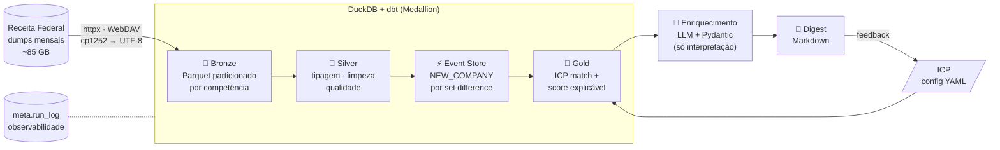

[English](README.md) · **Português**

<div align="center">

# 📡 Radar B2B

**Detecte mudanças. Encontre oportunidades. Aja primeiro.**

Motor de inteligência de eventos empresariais construído sobre os dados públicos do CNPJ —<br>
transforma as fotografias mensais de todas as empresas do país em **oportunidades comerciais priorizadas e explicáveis**.

[](https://github.com/GabrielKSG7/Radar-B2B/actions/workflows/ci.yml)


</div>

---

## Em resumo

| | |
|---|---|
| **Problema** | A Receita publica todo mês a base completa do CNPJ, mas como fotografias brutas — sem um "o que mudou". Quem vende para empresas novas (contadores, consultorias) descobre tarde, no boca a boca. |
| **O que faz** | Detecta eventos comparando competências consecutivas, cruza com um **ICP** configurável, pontua cada um com uma fórmula transparente e entrega um digest priorizado. |
| **O que não é** | Não é lista de leads nem busca de CNPJ. Vende **contexto, prioridade e ação** — todo score mostra os fatores que o compõem. |
| **Escala** | ~85 GB descompactados por competência, 10 fatias por tabela, codificação `cp1252`, processados num notebook. |
| **Custo** | Roda localmente, perto de R$ 0: DuckDB + Parquet + dbt, LLM opcional (Gemini free tier). |
| **Estado** | MVP. A primeira carga completa com dados reais (2024-07 → 2024-08, as 10 fatias, Minas Gerais) passou em todos os testes de dados e no teste de sanidade de população, gerando **42 oportunidades** para o primeiro ICP (escritórios de contabilidade do Sul de Minas). |

```
DADO → EVENTO → CONTEXTO → ICP → SCORE → OPORTUNIDADE → AÇÃO → FEEDBACK
```

---

## Arquitetura



| Camada | Responsabilidade | Tecnologia |
|---|---|---|
| Ingestão | Descoberta, download, validação e preparo dos dumps | Python, httpx |
| Bronze | Dados brutos **versionados por competência** | Parquet particionado |
| Silver | Tipagem, limpeza, joins, qualidade | dbt + DuckDB |
| Event Store | Eventos detectados por *set difference* entre competências | dbt + DuckDB |
| Opportunity Layer | ICP matching e scoring explicável | dbt + config YAML |
| Enriquecimento | Interpretação semântica controlada | Pydantic + LLM |
| Digest | Entrega ao usuário, com marcações de feedback | Markdown |
| Observabilidade | Run log de todas as etapas | DuckDB (`meta.run_log`) |

---

## Exemplo de saída

Trecho de um digest real gerado pelo pipeline do CI a partir de **fixtures sintéticas** (nomes e contatos fictícios):

> ### AURORA NOVA ERA LTDA
> **CNPJ:** `00000436000199` · **Score:** 67/100 (Média)
>
> | | |
> |---|---|
> | **Evento** | NEW_COMPANY — aberta em 2026-08-11 (há 20 dias) |
> | **Onde** | VARGINHA/MG |
> | **Setor** | Desenvolvimento de programas de computador sob encomenda (`6201501`) |
> | **Porte** | Empresa de Pequeno Porte |
>
> **Por que apareceu:** Aberta há 20 dias (+17) · CNAE secundario (+15) · Empresa de Pequeno Porte (+15) · VARGINHA (+10) · Contato disponível (+10)
>
> **Ação sugerida:** Revisar manualmente antes de abordar.
>
> `[ ] relevante   [ ] irrelevante   [ ] contatada` — motivo: ______________

Todo número é rastreável: o score é exatamente a soma dos fatores exibidos, e um teste dbt (`assert_score_bate_com_fatores`) quebra o build se isso deixar de ser verdade.

---

## Decisões técnicas

| Decisão | Por quê | Garantida por |
|---|---|---|
| **A competência é cidadã de primeira classe.** Empresas novas são encontradas comparando a fotografia do mês com a do mês anterior — não filtrando por data de abertura. | A fonte não tem log de mudanças. O *set difference* torna o pipeline **idempotente** e é a base de todos os eventos futuros. | `evt_new_company` + teste `assert_evento_nao_existe_na_competencia_anterior` |
| **Recência é medida contra o fim da competência, nunca contra o relógio.** | Reprocessar agosto de 2024 hoje tem de dar o mesmo score do ano passado. Com `current_date`, a janela de 45 dias zerava o Gold em silêncio. | Macro `data_referencia()` |
| **Ingestão e transformação derivam a competência de uma fonte única.** | Quando divergiram, o pipeline reportou dez modelos verdes e produziu zero eventos. | Orquestrador (`run_pipeline.py`) |
| **Detecção de mudança exige as dez fatias nas duas competências.** | As fatias não são estáveis: 69% dos CNPJs da fatia 0 de julho não estavam na fatia 0 de agosto. Um diff parcial mede amostragem, não abertura de empresas. | A ingestão recusa digest de carga parcial; `scripts/diagnostico_eventos.py` |
| **Setor por código CNAE, nunca por texto da descrição.** | `ilike '%ti%'` casava com "a**ti**vidades" — quase toda descrição de setor — e o filtro ficava inerte. | Schema do ICP em YAML |
| **A IA interpreta; nunca decide.** | Fato, score e aderência ao ICP são determinísticos. O modelo só escreve a leitura comercial, validada por Pydantic, com a proveniência exibida no digest. | `src/enriquecimento.py` |
| **Testes de regressão chamam o código de produção.** | Dois testes já passaram contra código quebrado porque testavam uma cópia da query. Cada teste novo foi verificado falhando contra o bug que protege. | `tests/` |

---

## Início rápido

```bash
git clone https://github.com/GabrielKSG7/Radar-B2B.git && cd Radar-B2B
python -m venv .venv && source .venv/bin/activate    # Windows: .venv\Scripts\activate
pip install -e ".[dev]"          # acrescente ",ia" para o enriquecimento por LLM
```

**Com dados sintéticos** (recomendado para começar — sem baixar 85 GB):

```bash
python scripts/gerar_fixtures.py --anterior 2026-07 --atual 2026-08
python run_pipeline.py --competencia 2026-08 --anterior 2026-07 --somente-local --sem-ia
```

O digest sai em `data/digests/`. As fixtures reproduzem os defeitos reais da fonte (acentos, `;` dentro de campos, bytes cp1252, linhas sem aspas) — é isso que faz do CI uma proteção de regressão de verdade.

**Com dados reais** — o pipeline *descobre* as competências publicadas em vez de adivinhá-las:

```bash
python -m src.ingestao --listar
export GEMINI_API_KEY=...                    # opcional
python run_pipeline.py --competencia 2026-08 --anterior 2026-07 --uf MG
```

A ingestão processa uma fatia por vez e apaga cada CSV extraído antes da próxima, então o pico de disco fica em poucos GB em vez de passar de 100 GB.

**Antes de confiar em um digest**, rode o teste de sanidade — ele mede se as duas competências descrevem a mesma população e se recusa a aprovar caso contrário:

```bash
python scripts/diagnostico_eventos.py
```

<details>
<summary><b>Executando etapas isoladas</b></summary>

```bash
python -m src.ingestao --competencia 2026-08 --uf MG
python scripts/carregar_icp.py
cd dbt_radar && dbt build --profiles-dir . \
  --vars "{competencia_atual: '2026-08', competencia_anterior: '2026-07'}"
python -m src.enriquecimento
python -m src.digest --top 20
```
</details>

<details>
<summary><b>Fonte dos dados — onde ficam os arquivos (e o que fazer se o download falhar)</b></summary>

Até janeiro de 2026 a base era publicada em `dadosabertos.rfb.gov.br/CNPJ/dados_abertos_cnpj/AAAA-MM/`. **Esse host foi desativado.** A publicação passou para um compartilhamento WebDAV (Nextcloud) em `arquivos.receitafederal.gov.br`, acessado por um token de compartilhamento.

| Recurso | Endereço |
|---|---|
| Página do compartilhamento (humano) | `arquivos.receitafederal.gov.br/index.php/s/<token>` |
| Listagem WebDAV (usada pelo código) | `arquivos.receitafederal.gov.br/public.php/webdav` |
| Download direto | `arquivos.receitafederal.gov.br/public.php/dav/files/<token>/<AAAA-MM>/<arquivo>` |
| Catálogo oficial | [dados.gov.br — CNPJ](https://dados.gov.br/dados/conjuntos-dados/cadastro-nacional-da-pessoa-juridica---cnpj) |
| Dicionário de dados | [cnpj-metadados.pdf](https://www.gov.br/receitafederal/dados/cnpj-metadados.pdf) |

**Se os downloads começarem a falhar**, o token provavelmente mudou. Abra a página do compartilhamento, navegue até *Dados > Cadastros > CNPJ*, copie o código que aparece depois de `/index.php/s/` e exporte — sem mudar código:

```bash
export RADAR_RFB_SHARE_TOKEN=<novo_token>
```
</details>

<details>
<summary><b>Formato dos arquivos — três armadilhas que causam perda silenciosa de dados</b></summary>

| Propriedade | Consequência de ignorar |
|---|---|
| Codificação **Windows-1252** (não latin-1) | Lido como UTF-8, toda linha com acento é descartada sem aviso; lido como latin-1, o DuckDB aborta o arquivo inteiro |
| Campos entre aspas duplas | As aspas ficam dentro do valor: `"MG"` nunca casa com `'MG'` |
| `;` dentro de campos e descrições | Vira coluna extra e aborta o arquivo |

A fonte é *quase* latin-1, mas carrega bytes `0x80–0x9F` — aspas curvas e travessões digitados no Windows, comuns em razões sociais. O DuckDB não lê cp1252, então a **extração** normaliza tudo para UTF-8 (sem custo extra de I/O) e o resto do pipeline lê UTF-8. Detalhes no `CHANGELOG.pt-BR.md`, versões 2.1.2 e 2.1.3.
</details>

---

## Configurando um ICP

O ICP é **configuração, não código**. Para atender um novo cliente, crie um arquivo em `config/icp/` e rode `python scripts/carregar_icp.py`:

```yaml
nome: meu_cliente
oferta: "Descrição do serviço oferecido"
geografia:
  uf: [MG]
  municipios: [VARGINHA, TRES CORACOES]
cnae:
  primarios: ['5611201', '4781400']    # sempre por CÓDIGO, nunca por texto da descrição
  secundarios: ['6201501']
  excluidos: ['6920601']
porte:
  alvo: ['01', '03']
eventos: [NEW_COMPANY]
recencia_dias: 45
pesos: {recencia: 30, cnae: 25, porte: 15, localizacao: 10, capital: 10, contexto: 10}
score_minimo: 40
```

Depois: `python run_pipeline.py --icp meu_cliente ...`

---

## O que a IA faz — e o que não faz

O LLM é uma **camada de interpretação, nunca fonte de verdade**.

| Responsabilidade | Determinístico | LLM |
|---|:---:|:---:|
| O fato do evento | ✅ | — |
| Score e fatores | ✅ | — |
| Aderência ao ICP | ✅ | — |
| Interpretação semântica | — | ✅ |
| Explicação e ação sugerida | — | ✅ |

A saída é validada com Pydantic e o prompt proíbe inventar faturamento, número de funcionários, contatos ou patrimônio. Toda oportunidade carrega a **proveniência** do enriquecimento (`llm` ou `heuristica`). Se o modelo estiver indisponível, o digest avisa — nunca é preenchido com texto fabricado passando por análise.

---

## Qualidade

```bash
ruff check src scripts tests run_pipeline.py
pytest -q
cd dbt_radar && dbt build --profiles-dir .    # inclui os testes de dados
```

**45 testes unitários e 25 testes de dados dbt**, todos executados a cada push pelo CI, de ponta a ponta, sobre fixtures sintéticas. O teste principal: `assert_evento_nao_existe_na_competencia_anterior` — nenhum evento `NEW_COMPANY` pode referenciar um CNPJ que já existia na competência anterior.

---

## Governança e LGPD

Dado público não elimina a responsabilidade pelo tratamento. O projeto usa apenas dados de pessoa jurídica da base aberta da Receita Federal; **não** ingere a tabela de sócios (dados de pessoa física) no MVP; registra a origem (competência) e a finalidade de todo registro processado; mantém e-mail e telefone do estabelecimento apenas para viabilizar o contato comercial, sem cruzamento com outras bases; e não faz enriquecimento indiscriminado.

---

## Roadmap

- [x] Bronze com particionamento por competência
- [x] Silver com testes de qualidade
- [x] `NEW_COMPANY` por *set difference*
- [x] ICP configurável e Opportunity Score explicável
- [x] Enriquecimento com grounding e proveniência
- [x] Digest priorizado + captura de feedback
- [x] Observabilidade e CI
- [x] Primeira carga completa com dados reais (2024-07 → 2024-08, MG)
- [ ] Decisão de LGPD sobre empresário individual (86% das 42 primeiras oportunidades; a razão social é nome de pessoa física)
- [ ] Validação concierge com escritórios de Varginha
- [ ] Novos eventos (`STATUS_CHANGED`, `PARTNER_*`) — só depois da validação
- [ ] Dashboard / API — só depois da validação comercial

A ordem é proposital: *a próxima camada de tecnologia só é priorizada quando há evidência de valor na anterior.*

---

## Documentos

- [`ENGINEERING_REVIEW.pt-BR.md`](ENGINEERING_REVIEW.pt-BR.md) — auditoria da implementação contra o plano diretor
- [`CHANGELOG.pt-BR.md`](CHANGELOG.pt-BR.md) — histórico de mudanças, incluindo cada armadilha encontrada nos dados
- *Plano Diretor* e *Cartilha* (estratégia e manual de execução) — mantidos fora do repositório

---

<div align="center">
<sub>Feito por <a href="https://github.com/GabrielKSG7">Gabriel Grande</a> · <a href="https://www.linkedin.com/in/gabriel-grande/">LinkedIn</a></sub>
</div>
